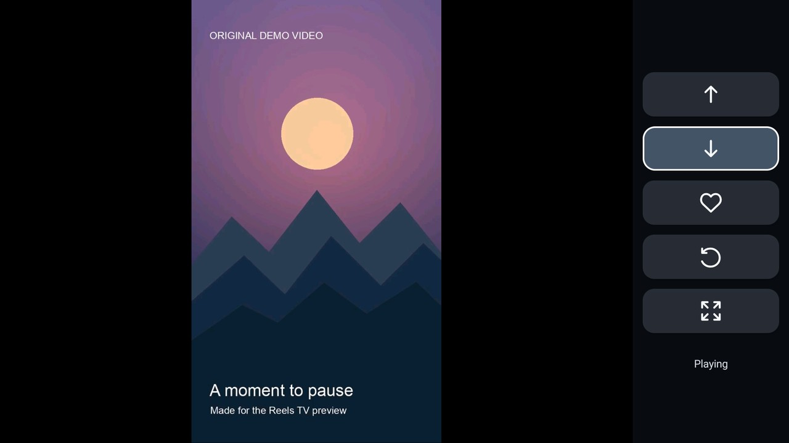

[English](README.md) | [简体中文](docs/README.zh-CN.md) | [繁體中文（港澳台）](docs/README.zh-Hant.md) | [日本語](docs/README.ja.md) | [한국어](docs/README.ko.md)

# Reels TV 2.12

A remote-friendly Android TV interface for watching Instagram Reels. Reels TV opens Instagram's official website in a WebView and plays available video in a TV-oriented player with a simple icon-based control rail.

Watching Reels is the core experience. Choose the standard edition for Reels alone, or the optional Xunlei Cloud Drive edition if you also want to save videos to a Xunlei cloud drive. The standard edition has no Xunlei button and does not require a Xunlei account. We chose Xunlei for this optional feature simply because we happened to find a free cloud drive with ample space for our needs. Available space and terms may change; Xunlei is not required to use Reels TV.

This is an independent project. It is not affiliated with, endorsed by, or an official product of Instagram, Meta, or Xunlei. Instagram's website and available features may change without notice.

## Preview



[Watch the 12-second television recording](docs/media/reels-tv-television.mp4). This offline demonstration uses an original sample video and simulated Instagram actions; it does not show a real account or live Instagram content.

## Features

- Navigate to the previous or next Reel with a TV remote.
- Like a Reel when the corresponding Instagram control is available; a filled heart indicates a confirmed like.
- Rotate a video left and switch between automatic zoom and original proportions. Display preferences are remembered per Reel on the device.
- Use the official web page with a remote-controlled pointer when needed.
- The app interface supports English, Japanese, Korean, Traditional Chinese, and Simplified Chinese and follows the device language; other languages fall back to English. Choose the documentation language using the links above. Third-party official websites may use their own languages.
- Pause automatic connections when Instagram requests verification or returns a rate-limit response. You decide when to continue on the official page.

The application does not guarantee that a particular video, control, or account session will remain available. Do not treat it as a way to bypass verification or account restrictions.

## Device requirements

- Android 8.0 (API 26) or later, with an Android TV-compatible remote and working WebView.
- An ARM Android device supporting `armeabi-v7a` or `arm64-v8a`. Compatibility varies by device; 2.12 has not been verified on every device or architecture.
- Network access to Instagram and its media servers. The optional Xunlei Cloud Drive edition also requires access to Xunlei to save videos. Sign in on the official pages when prompted. The app has its own WebView session and does not import the session from the official Instagram app.

The optional Instagram Remote Assistant accessibility service is for controlling the separate official Instagram app. Reels TV itself does not require enabling it. If enabled, Android grants the service access to window information, directional keys and gesture simulation; the service filters keys only while the official Instagram app is active and the keyboard is closed.

### Optional Xunlei Cloud Drive edition

In the Xunlei Cloud Drive edition, the cloud button opens the official Xunlei website inside Reels TV; no companion app is required. Sign in to your own Xunlei account in that window and create a folder named exactly `Reels TV` at the root of your cloud drive before saving. If the folder is missing, create it yourself and try again. The official website may display Chinese regardless of the app language.

The app prepares the current Reel as a temporary video, submits it through Xunlei's upload page, and reports success only after the website indicates that the upload finished and the refreshed folder shows the file. It does not rely on an old local saved marker. Canceling or an unconfirmed upload is not reported as success. A separate test build uploaded a generated test video to Xunlei; this did not verify downloading an actual Reel or the complete flow on every device. Changes to Xunlei's website, login, file list, or upload interface may prevent the flow from working.

The save option requires a directly downloadable, playable video from Instagram's supported media hosts. Some Reels or accounts may not provide one. Downloads are limited to 512 MiB and require sufficient free space. Account access, network availability, website changes, and Xunlei's own restrictions can also prevent saving. Use this feature only for content you are allowed to save.

## Build, sign, and install

You need JDK 17, Android SDK Platform 34 and Build Tools 34.0.0. Set `ANDROID_HOME` to your Android SDK directory, or use Android Studio's local SDK configuration. The included Gradle wrapper downloads Gradle 8.9 with checksum verification on first use; Gradle also downloads the Android plugin and declared dependencies.

```sh
./gradlew assembleStandardRelease assembleXunleiRelease lintStandardRelease lintXunleiRelease
```

On Windows, use `gradlew.bat` instead. Choose one edition; both builds are **unsigned** and cannot be installed as-is:

```text
build/outputs/apk/standard/release/InstagramRemote-standard-release-unsigned.apk
build/outputs/apk/xunlei/release/InstagramRemote-xunlei-release-unsigned.apk
```

For example, to sign the standard edition, align its unsigned APK and sign it with your own securely managed release key. To sign the Xunlei Cloud Drive edition, substitute its path and a different output filename. Replace the keystore path and alias below; `zipalign` and `apksigner` are in the Android SDK's Build Tools directory. Keep the keystore and its passwords private.

```sh
zipalign -p -f 4 build/outputs/apk/standard/release/InstagramRemote-standard-release-unsigned.apk /tmp/Reels-TV-2.12-aligned.apk
apksigner sign --ks /path/to/release-keystore --ks-key-alias YOUR_KEY_ALIAS --out Reels-TV-2.12.apk /tmp/Reels-TV-2.12-aligned.apk
apksigner verify --verbose --print-certs Reels-TV-2.12.apk
```

Before installing a distributed APK, verify its signature with `apksigner verify --verbose --print-certs Reels-TV-2.12.apk` and compare the displayed SHA-256 certificate fingerprint with the publisher's fingerprint obtained through a trusted, independent channel. A successful verification alone does not establish who signed the APK. No publisher fingerprint is specified in this repository.

```sh
adb install -r Reels-TV-2.12.apk
```

Both editions use the same package name. Switching editions is an app update, not a separate plugin installation: use a matching signing certificate and a version Android accepts to preserve the app's existing local data and sessions. Android will not update an installation signed by a different key. Uninstalling an existing installation removes its local data and WebView session. The expected signed filename does not imply that a signed APK is included or has been published.

## Remote controls

| Control | Action |
| --- | --- |
| Up / down | Select a button in the sidebar |
| OK | Activate the selected button |
| Left | Enter the Instagram page and use the pointer |
| Right at the page edge | Return to the sidebar |
| Play / pause | Pause or resume the video |
| Back, Home, volume | Normal system behavior |

Buttons may be unavailable while a page or video is loading or when Instagram does not expose the corresponding action. Automatic zoom may crop content; use the picture button to restore the original proportions.

## Tests

The JavaScript tests use Node.js 18 or newer and do not contact Instagram:

```sh
node --test tests/*.test.cjs tests/*.test.mjs
```

The `debug` build uses the separate `com.gathin.instagramremote.checks` application ID and removes network permissions. Its device-side safety checks also require locally supplied test videos in the test app's cache. Those video fixtures are **not included** in this repository, so the complete device-side playback suite cannot be reproduced from this repository alone. The JavaScript tests and local device checks do not prove how the live Instagram or Xunlei websites, an upload, or an individual account will behave.

## Privacy and data

The app connects to Instagram and Facebook media hosts for the official page and playback. In the optional Xunlei Cloud Drive edition, when you use cloud saving, it downloads the current video from an Instagram media host into the app's private cache and uploads it to Xunlei through the official website. The temporary file is removed when the flow finishes or is closed; an interrupted app process may leave cached data until Android clears it. Xunlei receives the uploaded video and handles it under its own terms and privacy policy.

The app's WebView stores its own website sessions and cookies on the device. Sign in yourself on the official Instagram and Xunlei pages; the app does not import login data from another app or read or copy your credentials or cookies for the cloud save flow. The app stores per-video rotation and zoom preferences locally. Android backup is disabled. No account credentials, cookies, personal viewing history, private network settings, or signing keys are included in this repository.

If you enable the optional accessibility service, review the permissions and behavior described above. Content availability depends on the service and the account's access.

## License and attribution

Project source is distributed under the [MIT License](LICENSE). The project was developed alongside [CleanYourTV](https://github.com/Gathin23/cleanyourtv); its copyright notice is retained. The Gradle wrapper, AndroidX libraries, and LibVLC are separate third-party components with their own licenses; see [THIRD_PARTY.md](THIRD_PARTY.md). License obligations for a distributed APK can differ from those for this source repository.
