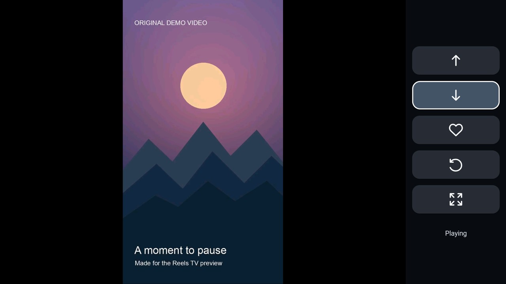

[English](../README.md) | [简体中文](README.zh-CN.md) | [繁體中文（港澳台）](README.zh-Hant.md) | [日本語](README.ja.md) | [한국어](README.ko.md)

# Reels TV 2.12

Instagram Reels をリモコンで視聴しやすくする Android TV 向けインターフェースです。Reels TV は WebView で Instagram の公式サイトを開き、視聴可能な動画をテレビ向けプレーヤーとシンプルなアイコン式の操作バーで再生します。

中心となる体験は Reels の視聴です。Reels の視聴だけなら標準版、動画を Xunlei のクラウドドライブにも保存したい場合はオプションの Xunlei Cloud Drive 版を選べます。標準版には Xunlei ボタンがなく、Xunlei アカウントも不要です。この機能に Xunlei を選んだ理由は、私たちの用途に十分な容量を備えた無料のクラウドドライブをたまたま見つけたためです。利用可能な容量や条件は変わることがあります。Reels TV の利用に Xunlei は必要ありません。

このプロジェクトは独立しており、Instagram、Meta、Xunlei と提携・公認された製品でも、各社の公式製品でもありません。Instagram のウェブサイトや利用可能な機能は予告なく変わる場合があります。

## テレビでのデモ



[12秒のテレビ録画を見る](media/reels-tv-television.mp4). このオフラインデモはオリジナルのサンプル動画を使用し、Instagram の操作は模擬したものです。実際のアカウントや Instagram のコンテンツは表示していません。

## 機能

- テレビのリモコンで前後の Reel に移動。
- Instagram に対応する操作が表示されている場合に Reel に「いいね」。塗りつぶされたハートは確認済みの「いいね」を示します。
- 動画を左に回転し、自動ズームと元の比率を切り替え。表示設定は Reel ごとに端末に保存されます。
- 必要に応じてリモコン操作のポインターで公式ウェブページを使用。
- アプリの画面は英語、日本語、韓国語、繁体字中国語、簡体字中国語に対応し、端末の言語に従います。その他の言語では英語にフォールバックします。ドキュメントの言語は上のリンクから選択できます。第三者の公式ウェブページは独自の言語で表示される場合があります。
- Instagram が認証を求めた場合やレート制限の応答を返した場合、自動接続を一時停止。公式ページでいつ再開するかは利用者が決めます。

特定の動画、操作、アカウントのセッションが引き続き利用できることは保証されません。認証やアカウント制限を回避する手段として使用しないでください。

## 動作要件

- Android 8.0（API 26）以降、Android TV 対応リモコン、動作する WebView。
- `armeabi-v7a` または `arm64-v8a` に対応した ARM Android 端末。互換性は端末によって異なります。2.12 はすべての端末やアーキテクチャで検証されていません。
- Instagram とそのメディアサーバーへのネットワーク接続。オプションの Xunlei Cloud Drive 版で動画を保存するには Xunlei への接続も必要です。求められたら公式ページでログインしてください。アプリは独自の WebView セッションを使用し、Instagram 公式アプリのセッションを取り込みません。

オプションのユーザー補助サービス Instagram Remote Assistant は、別の Instagram 公式アプリを操作するためのものです。Reels TV 自体に有効化は不要です。有効にすると Android はウィンドウ情報、方向キー、ジェスチャーのシミュレーションへのアクセスをサービスに許可します。サービスがキーをフィルターするのは、Instagram 公式アプリがアクティブでキーボードが閉じている間だけです。

### オプションの Xunlei Cloud Drive 版

Xunlei Cloud Drive 版では、クラウドボタンで Reels TV 内に Xunlei 公式サイトを開きます。連携アプリは不要です。保存する前に、その画面で自分の Xunlei アカウントにログインし、クラウドドライブのルートに名前が正確に `Reels TV` であるフォルダーを作成してください。フォルダーがない場合は自分で作成してから再試行してください。アプリの言語にかかわらず、公式サイトは中国語で表示される場合があります。

アプリは現在の Reel を一時動画として準備し、Xunlei のアップロードページから送信します。サイトがアップロード完了を示し、更新後のフォルダーにファイルが表示された場合にのみ成功を報告します。古いローカルの保存済みマークには依存しません。キャンセルや未確認のアップロードを成功とは報告しません。別のテストビルドでは生成したテスト動画を Xunlei にアップロードしましたが、実際の Reel のダウンロードやすべての端末での一連の処理は検証していません。Xunlei のサイト、ログイン、ファイル一覧、アップロード画面の変更により動作しなくなる場合があります。

保存には、Instagram の対応メディアホストから直接ダウンロードでき、再生可能な動画が必要です。Reels やアカウントによっては提供されない場合があります。ダウンロードの上限は 512 MiB で、十分な空き容量が必要です。アカウントへのアクセス、ネットワーク、サイトの変更、Xunlei 自体の制限によっても保存できない場合があります。保存する権利のあるコンテンツにのみ使用してください。

## ビルド、署名、インストール

JDK 17、Android SDK Platform 34、Build Tools 34.0.0 が必要です。`ANDROID_HOME` に Android SDK ディレクトリを設定するか、Android Studio のローカル SDK 設定を使用してください。付属の Gradle wrapper は初回使用時に Gradle 8.9 をダウンロードしてチェックサムを検証します。Gradle は Android プラグインと指定された依存関係もダウンロードします。

```sh
./gradlew assembleStandardRelease assembleXunleiRelease lintStandardRelease lintXunleiRelease
```

Windows では代わりに `gradlew.bat` を使用してください。いずれかの版を選びます。両方の成果物は**未署名**のため、そのままではインストールできません。

```text
build/outputs/apk/standard/release/InstagramRemote-standard-release-unsigned.apk
build/outputs/apk/xunlei/release/InstagramRemote-xunlei-release-unsigned.apk
```

例えば標準版に署名するには、未署名 APK を整列し、適切に管理した自分のリリース鍵で署名します。Xunlei Cloud Drive 版に署名する場合は、そのパスと別の出力ファイル名に置き換えてください。以下のキーストアパスとエイリアスを置き換えてください。`zipalign` と `apksigner` は Android SDK の Build Tools ディレクトリにあります。キーストアとパスワードは非公開にしてください。

```sh
zipalign -p -f 4 build/outputs/apk/standard/release/InstagramRemote-standard-release-unsigned.apk /tmp/Reels-TV-2.12-aligned.apk
apksigner sign --ks /path/to/release-keystore --ks-key-alias YOUR_KEY_ALIAS --out Reels-TV-2.12.apk /tmp/Reels-TV-2.12-aligned.apk
apksigner verify --verbose --print-certs Reels-TV-2.12.apk
```

配布された APK をインストールする前に、`apksigner verify --verbose --print-certs Reels-TV-2.12.apk` で署名を検証し、表示された SHA-256 証明書フィンガープリントを信頼できる独立した経路で入手した発行者のフィンガープリントと比較してください。検証成功だけでは APK の署名者は確認できません。このリポジトリには発行者のフィンガープリントは記載されていません。

```sh
adb install -r Reels-TV-2.12.apk
```

両版のパッケージ名は同じです。版の切り替えは別のプラグインのインストールではなくアプリの更新です。既存のローカルデータとセッションを保持するには、一致する署名証明書と Android が受け付けるバージョンを使用してください。Android は異なる鍵で署名されたインストールを更新しません。既存のアプリをアンインストールするとローカルデータと WebView セッションは削除されます。署名済みファイルの想定名は、署名済み APK が含まれる、または公開されたことを意味しません。

## リモコン操作

| 操作 | 動作 |
| --- | --- |
| 上／下 | サイドバーのボタンを選択 |
| 決定 | 選択したボタンを実行 |
| 左 | Instagram ページに入りポインターを使用 |
| ページ端で右 | サイドバーに戻る |
| 再生／一時停止 | 動画を一時停止または再開 |
| 戻る、ホーム、音量 | 通常のシステム動作 |

ページや動画の読み込み中、または Instagram が対応する操作を提供していない場合、ボタンを使用できないことがあります。自動ズームでは画面が切り取られる場合があります。画面ボタンで元の比率に戻せます。

## テスト

JavaScript テストには Node.js 18 以降が必要で、Instagram に接続しません。

```sh
node --test tests/*.test.cjs tests/*.test.mjs
```

`debug` ビルドは別のアプリケーション ID `com.gathin.instagramremote.checks` を使用し、ネットワーク権限を削除します。端末側の安全チェックには、テストアプリのキャッシュに自分で用意したテスト動画も必要です。これらの動画はリポジトリに**含まれない**ため、このリポジトリだけでは端末側の再生テスト一式を再現できません。JavaScript テストとローカル端末のチェックは、実際の Instagram や Xunlei のサイト、アップロード、個々のアカウントの動作を保証するものではありません。

## プライバシーとデータ

アプリは公式ページと再生のために Instagram と Facebook のメディアホストに接続します。オプションの Xunlei Cloud Drive 版でクラウド保存を使用すると、現在の動画を Instagram のメディアホストからアプリの非公開キャッシュにダウンロードし、公式サイトを通じて Xunlei にアップロードします。処理が完了または終了すると一時ファイルは削除されますが、アプリのプロセスが中断した場合は Android が消去するまでキャッシュが残ることがあります。Xunlei はアップロードされた動画を受け取り、同社の規約とプライバシーポリシーに従って扱います。

アプリの WebView は独自のサイトセッションと Cookie を端末に保存します。Instagram と Xunlei の公式ページで自分でログインしてください。アプリは他のアプリからログインデータを取り込まず、クラウド保存のために認証情報や Cookie を読み取ったりコピーしたりしません。アプリは動画ごとの回転とズーム設定をローカルに保存します。Android バックアップは無効です。このリポジトリにはアカウント認証情報、Cookie、個人の視聴履歴、プライベートネットワーク設定、署名鍵は含まれていません。

オプションのユーザー補助サービスを有効にする場合は、上記の権限と動作を確認してください。コンテンツの利用可否はサービスとアカウントのアクセス権によって異なります。

## ライセンスと謝辞

プロジェクトのソースは [MIT License](../LICENSE) の下で配布されます。プロジェクトは [CleanYourTV](https://github.com/Gathin23/cleanyourtv) と並行して開発され、その著作権表示は保持されています。Gradle wrapper、AndroidX ライブラリ、LibVLC はそれぞれ独自のライセンスを持つ別個のサードパーティ製コンポーネントです。[THIRD_PARTY.md](../THIRD_PARTY.md) を参照してください。配布 APK のライセンス上の義務は、このソースリポジトリの場合と異なることがあります。
