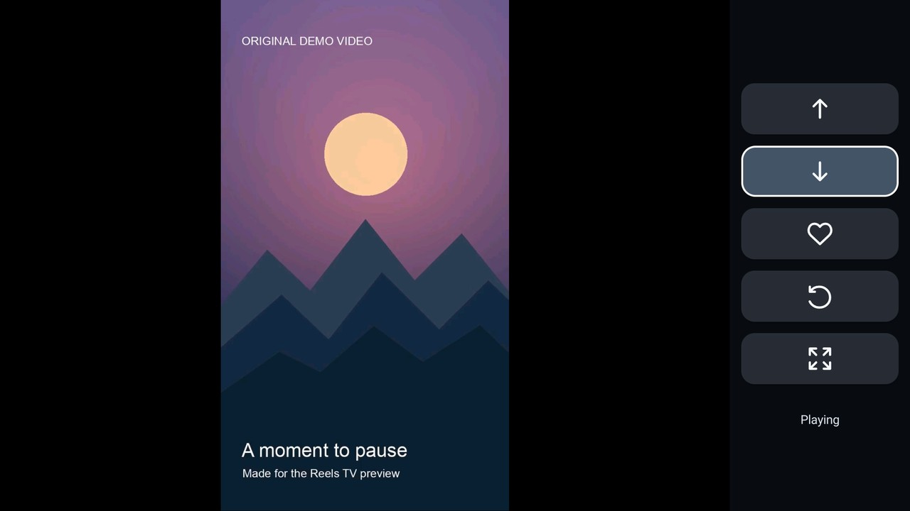

[English](../README.md) | [简体中文](README.zh-CN.md) | [繁體中文（港澳台）](README.zh-Hant.md) | [日本語](README.ja.md) | [한국어](README.ko.md)

# Reels TV 2.12

适合使用遥控器观看 Instagram Reels 的 Android TV 界面。Reels TV 在 WebView 中打开 Instagram 官方网站，并使用面向电视的播放器和简洁的图标控制栏播放可用视频。

观看 Reels 是核心体验。只需观看 Reels 可选择标准版；如需将视频保存到迅雷云盘，可选择可选的迅雷网盘版。标准版没有迅雷按钮，也不需要迅雷账号。选择迅雷提供此可选功能，只是因为我们恰好找到一个免费且空间足以满足自身需求的云盘。可用空间和条款可能变化；使用 Reels TV 不需要迅雷。

本项目是独立项目，并非 Instagram、Meta 或迅雷的关联、认可或官方产品。Instagram 网站及可用功能可能随时变化，恕不另行通知。

## 电视演示



[观看 12 秒电视录屏](media/reels-tv-television.mp4). 此离线演示使用原创样片，Instagram 操作是模拟的；画面不包含真实账号或 Instagram 内容。

## 功能

- 使用电视遥控器切换到上一条或下一条 Reel。
- Instagram 提供相应控件时可点赞 Reel；实心爱心表示点赞已确认。
- 向左旋转视频，在自动放大与原始比例之间切换。每条 Reel 的显示偏好会保存在设备上。
- 需要时使用遥控器控制的指针操作官方网页。
- 应用界面支持英语、日语、韩语、繁体中文和简体中文，并跟随设备语言；其他语言回退为英语。可通过上方链接自行选择文档语言。第三方官方网页可能仍使用其自身语言。
- Instagram 要求验证或返回请求频率限制响应时，暂停自动连接。何时在官方页面继续由你决定。

本应用不保证特定视频、控件或账号会话持续可用。请勿将其视为绕过验证或账号限制的方式。

## 设备要求

- Android 8.0（API 26）或更高版本，配备兼容 Android TV 的遥控器和可用的 WebView。
- 支持 `armeabi-v7a` 或 `arm64-v8a` 的 ARM Android 设备。兼容性因设备而异；2.12 尚未在每种设备或架构上验证。
- 能够连接 Instagram 及其媒体服务器。可选的迅雷网盘版保存视频时还需要连接迅雷。出现提示时请在官方页面登录。应用使用自己的 WebView 会话，不会导入 Instagram 官方应用的会话。

可选的 Instagram Remote Assistant 无障碍服务用于控制独立的 Instagram 官方应用。Reels TV 本身不需要启用此服务。启用后，Android 会授予该服务访问窗口信息、方向键和模拟手势的权限；该服务仅在 Instagram 官方应用处于活动状态且键盘关闭时过滤按键。

### 可选的迅雷网盘版

在迅雷网盘版中，云朵按钮会在 Reels TV 内打开迅雷官方网站，不需要配套应用。保存前，请在该窗口登录自己的迅雷账号，并在云盘根目录创建名称严格为 `Reels TV` 的文件夹。如果文件夹不存在，请自行创建后重试。无论应用使用何种语言，官方网站可能显示中文。

应用将当前 Reel 准备为临时视频，通过迅雷上传页面提交，并且只有在网站显示上传完成、刷新后的文件夹出现该文件时才报告成功。它不依赖旧的本地已保存标记。取消或未确认的上传不会报告为成功。一个单独的测试版本曾将生成的测试视频上传到迅雷；这并未验证实际 Reel 的下载或每台设备上的完整流程。迅雷网站、登录、文件列表或上传界面的变化可能导致流程无法工作。

保存功能需要来自 Instagram 支持的媒体主机、可直接下载且可播放的视频。部分 Reels 或账号可能无法提供此类视频。下载上限为 512 MiB，且需要足够的可用空间。账号访问、网络可用性、网站变化及迅雷自身限制也可能导致保存失败。请仅对你有权保存的内容使用此功能。

## 构建、签名和安装

需要 JDK 17、Android SDK Platform 34 和 Build Tools 34.0.0。将 `ANDROID_HOME` 设置为 Android SDK 目录，或使用 Android Studio 的本地 SDK 配置。随附的 Gradle wrapper 首次使用时会下载 Gradle 8.9 并验证校验和；Gradle 还会下载 Android 插件和声明的依赖。

```sh
./gradlew assembleStandardRelease assembleXunleiRelease lintStandardRelease lintXunleiRelease
```

Windows 用户请使用 `gradlew.bat`。选择一个版本；两个构建产物均**未签名**，不能直接安装：

```text
build/outputs/apk/standard/release/InstagramRemote-standard-release-unsigned.apk
build/outputs/apk/xunlei/release/InstagramRemote-xunlei-release-unsigned.apk
```

例如，要为标准版签名，请先对未签名 APK 执行对齐，再使用自己妥善管理的发布密钥签名。为迅雷网盘版签名时，请替换其路径并使用不同的输出文件名。请替换下方的密钥库路径和别名；`zipalign` 和 `apksigner` 位于 Android SDK 的 Build Tools 目录中。请保密密钥库及其密码。

```sh
zipalign -p -f 4 build/outputs/apk/standard/release/InstagramRemote-standard-release-unsigned.apk /tmp/Reels-TV-2.12-aligned.apk
apksigner sign --ks /path/to/release-keystore --ks-key-alias YOUR_KEY_ALIAS --out Reels-TV-2.12.apk /tmp/Reels-TV-2.12-aligned.apk
apksigner verify --verbose --print-certs Reels-TV-2.12.apk
```

安装分发的 APK 前，请使用 `apksigner verify --verbose --print-certs Reels-TV-2.12.apk` 验证签名，并将显示的 SHA-256 证书指纹与通过可信独立渠道取得的发布者指纹进行比较。仅验证成功不能证明 APK 的签名者。本仓库未指定发布者指纹。

```sh
adb install -r Reels-TV-2.12.apk
```

两个版本使用相同的包名。切换版本属于应用更新，而非安装独立插件：要保留现有本地数据和会话，请使用相同的签名证书及 Android 接受的版本。Android 不会更新由不同密钥签名的现有安装。卸载现有应用会删除其本地数据和 WebView 会话。预期的已签名文件名并不表示仓库包含或已经发布了已签名 APK。

## 遥控器操作

| 按键 | 操作 |
| --- | --- |
| 上／下 | 选择侧边栏中的按钮 |
| 确认 | 执行选中的按钮 |
| 左 | 进入 Instagram 页面并使用指针 |
| 在页面边缘按右 | 返回侧边栏 |
| 播放／暂停 | 暂停或继续播放视频 |
| 返回、主页、音量 | 系统正常行为 |

页面或视频加载时，或 Instagram 未提供相应操作时，按钮可能不可用。自动放大可能裁切画面；使用画面按钮可恢复原始比例。

## 测试

JavaScript 测试需要 Node.js 18 或更高版本，不会连接 Instagram：

```sh
node --test tests/*.test.cjs tests/*.test.mjs
```

`debug` 构建使用独立的 `com.gathin.instagramremote.checks` 应用 ID，并移除网络权限。设备端安全检查还需要在测试应用缓存中自行提供测试视频。本仓库**不包含**这些视频素材，因此仅凭本仓库无法复现完整的设备端播放测试。JavaScript 测试和本地设备检查不能证明 Instagram 或迅雷实时网站、上传或个别账号的实际行为。

## 隐私和数据

应用为官方页面和播放连接 Instagram 与 Facebook 媒体主机。在可选的迅雷网盘版中，使用云端保存时，应用会将当前视频从 Instagram 媒体主机下载到应用私有缓存，再通过官方网站上传到迅雷。流程完成或关闭时会删除临时文件；应用进程中断可能使缓存数据保留至 Android 清除。迅雷接收上传的视频，并按照其自身条款和隐私政策处理。

应用的 WebView 在设备上保存自己的网页会话和 Cookie。请自行在 Instagram 和迅雷官方页面登录；应用不会从其他应用导入登录数据，也不会为云端保存流程读取或复制你的凭据或 Cookie。应用在本地保存每条视频的旋转和缩放偏好。Android 备份已禁用。本仓库不包含账号凭据、Cookie、个人观看记录、私有网络设置或签名密钥。

如果启用可选的无障碍服务，请查看上文所述权限和行为。内容可用性取决于服务及账号的访问权限。

## 许可证和致谢

项目源码依据 [MIT License](../LICENSE) 分发。项目与 [CleanYourTV](https://github.com/Gathin23/cleanyourtv) 一同开发，并保留其版权声明。Gradle wrapper、AndroidX 库和 LibVLC 是具有各自许可证的独立第三方组件；参见 [THIRD_PARTY.md](../THIRD_PARTY.md)。分发 APK 的许可义务可能与此源码仓库不同。
