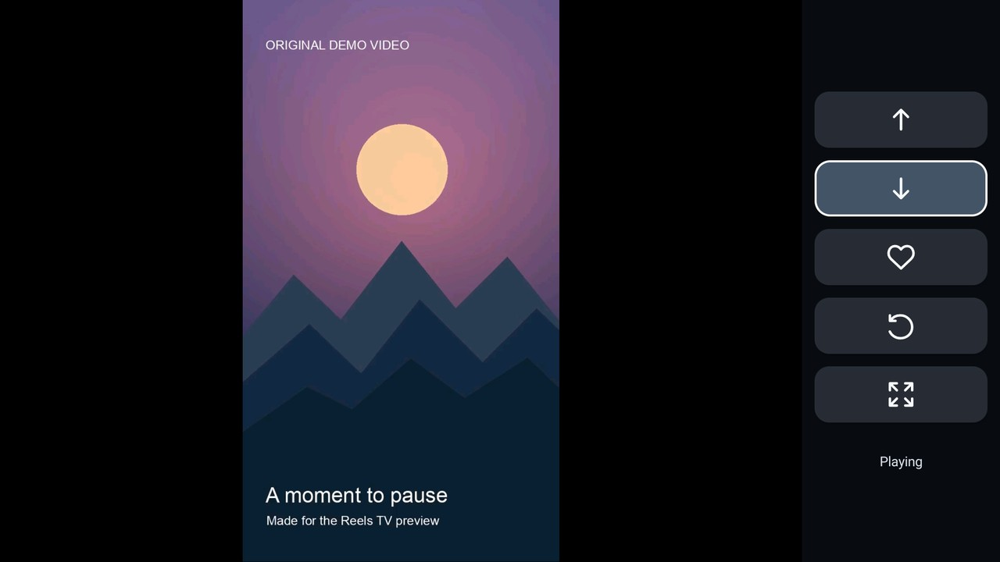

[English](../README.md) | [简体中文](README.zh-CN.md) | [繁體中文（港澳台）](README.zh-Hant.md) | [日本語](README.ja.md) | [한국어](README.ko.md)

# Reels TV 2.12

適合使用遙控器觀看 Instagram Reels 的 Android TV 介面。Reels TV 在 WebView 中開啟 Instagram 官方網站，並以適合電視使用的播放器和簡潔的圖示控制列播放可用影片。

觀看 Reels 是核心體驗。只需觀看 Reels 可選擇標準版；如需將影片儲存至迅雷雲端硬碟，可選擇選用的迅雷雲盤版。標準版沒有迅雷按鈕，也不需要迅雷帳號。選擇迅雷提供此選用功能，只是因為我們碰巧找到一個免費且空間足以滿足自身需求的雲端硬碟。可用空間和條款可能改變；使用 Reels TV 不需要迅雷。

本專案是獨立專案，並非 Instagram、Meta 或迅雷的關聯、認可或官方產品。Instagram 網站及可用功能可能隨時變更，恕不另行通知。

## 電視示範



[觀看 12 秒電視錄影](media/reels-tv-television.mp4). 此離線示範使用原創樣片，Instagram 操作為模擬；畫面不包含真實帳號或 Instagram 內容。

## 功能

- 使用電視遙控器切換至上一則或下一則 Reel。
- Instagram 提供相應控制項時可讚好 Reel；實心愛心表示讚好已獲確認。
- 向左旋轉影片，在自動放大與原始比例之間切換。每則 Reel 的顯示偏好會儲存在裝置上。
- 需要時使用遙控器控制的指標操作官方網頁。
- 應用程式介面支援英語、日語、韓語、繁體中文和簡體中文，並跟隨裝置語言；其他語言會回退至英語。可透過上方連結自行選擇文件語言。第三方官方網頁可能仍使用其自身語言。
- Instagram 要求驗證或回傳請求頻率限制回應時，暫停自動連線。何時在官方頁面繼續由你決定。

本應用程式不保證特定影片、控制項或帳號工作階段持續可用。請勿將其視為繞過驗證或帳號限制的方式。

## 裝置需求

- Android 8.0（API 26）或更新版本，配備相容 Android TV 的遙控器和可用的 WebView。
- 支援 `armeabi-v7a` 或 `arm64-v8a` 的 ARM Android 裝置。相容性因裝置而異；2.12 尚未在每種裝置或架構上驗證。
- 能夠連線至 Instagram 及其媒體伺服器。選用的迅雷雲盤版儲存影片時還需要連線至迅雷。出現提示時請在官方頁面登入。應用程式使用自己的 WebView 工作階段，不會匯入 Instagram 官方應用程式的工作階段。

選用的 Instagram Remote Assistant 無障礙服務用於控制獨立的 Instagram 官方應用程式。Reels TV 本身不需要啟用此服務。啟用後，Android 會授予該服務存取視窗資訊、方向鍵和模擬手勢的權限；該服務僅在 Instagram 官方應用程式處於使用中且鍵盤關閉時過濾按鍵。

### 選用的迅雷雲盤版

在迅雷雲盤版中，雲朵按鈕會在 Reels TV 內開啟迅雷官方網站，不需要配套應用程式。儲存前，請在該視窗登入自己的迅雷帳號，並在雲端硬碟根目錄建立名稱完全為 `Reels TV` 的資料夾。如果資料夾不存在，請自行建立後重試。無論應用程式使用何種語言，官方網站可能顯示中文。

應用程式將目前的 Reel 準備為暫存影片，透過迅雷上傳頁面提交，並且只有在網站顯示上傳完成、重新整理後的資料夾出現該檔案時才回報成功。它不依賴舊的本機已儲存標記。取消或未確認的上傳不會回報為成功。一個獨立測試版本曾將產生的測試影片上傳至迅雷；這並未驗證實際 Reel 的下載或每台裝置上的完整流程。迅雷網站、登入、檔案清單或上傳介面的變更可能導致流程無法運作。

儲存功能需要來自 Instagram 支援的媒體主機、可直接下載且可播放的影片。部分 Reels 或帳號可能無法提供此類影片。下載上限為 512 MiB，且需要足夠的可用空間。帳號存取、網路可用性、網站變更及迅雷自身限制也可能導致儲存失敗。請僅對你有權儲存的內容使用此功能。

## 建置、簽署和安裝

需要 JDK 17、Android SDK Platform 34 和 Build Tools 34.0.0。將 `ANDROID_HOME` 設為 Android SDK 目錄，或使用 Android Studio 的本機 SDK 設定。隨附的 Gradle wrapper 首次使用時會下載 Gradle 8.9 並驗證校驗和；Gradle 也會下載 Android 外掛及宣告的相依套件。

```sh
./gradlew assembleStandardRelease assembleXunleiRelease lintStandardRelease lintXunleiRelease
```

Windows 使用者請使用 `gradlew.bat`。選擇一個版本；兩個建置產物均**未簽署**，不能直接安裝：

```text
build/outputs/apk/standard/release/InstagramRemote-standard-release-unsigned.apk
build/outputs/apk/xunlei/release/InstagramRemote-xunlei-release-unsigned.apk
```

例如，要為標準版簽署，請先對未簽署的 APK 執行對齊，再使用自己妥善管理的發行金鑰簽署。為迅雷雲盤版簽署時，請替換其路徑並使用不同的輸出檔名。請替換下方的金鑰庫路徑和別名；`zipalign` 和 `apksigner` 位於 Android SDK 的 Build Tools 目錄中。請保密金鑰庫及其密碼。

```sh
zipalign -p -f 4 build/outputs/apk/standard/release/InstagramRemote-standard-release-unsigned.apk /tmp/Reels-TV-2.12-aligned.apk
apksigner sign --ks /path/to/release-keystore --ks-key-alias YOUR_KEY_ALIAS --out Reels-TV-2.12.apk /tmp/Reels-TV-2.12-aligned.apk
apksigner verify --verbose --print-certs Reels-TV-2.12.apk
```

安裝已分發的 APK 前，請使用 `apksigner verify --verbose --print-certs Reels-TV-2.12.apk` 驗證簽章，並將顯示的 SHA-256 憑證指紋與透過可信獨立管道取得的發行者指紋比較。僅驗證成功不能證明 APK 的簽署者。本儲存庫未指定發行者指紋。

```sh
adb install -r Reels-TV-2.12.apk
```

兩個版本使用相同的套件名稱。切換版本屬於應用程式更新，而非安裝獨立外掛：要保留現有本機資料和工作階段，請使用相同的簽署憑證及 Android 接受的版本。Android 不會更新由不同金鑰簽署的現有安裝。解除安裝現有應用程式會刪除其本機資料和 WebView 工作階段。預期的已簽署檔名並不表示儲存庫包含或已發佈已簽署的 APK。

## 遙控器操作

| 按鍵 | 操作 |
| --- | --- |
| 上／下 | 選擇側邊欄中的按鈕 |
| 確認 | 執行選取的按鈕 |
| 左 | 進入 Instagram 頁面並使用指標 |
| 在頁面邊緣按右 | 返回側邊欄 |
| 播放／暫停 | 暫停或繼續播放影片 |
| 返回、主畫面、音量 | 系統正常行為 |

頁面或影片載入時，或 Instagram 未提供相應操作時，按鈕可能無法使用。自動放大可能裁切畫面；使用畫面按鈕可恢復原始比例。

## 測試

JavaScript 測試需要 Node.js 18 或更新版本，不會連線至 Instagram：

```sh
node --test tests/*.test.cjs tests/*.test.mjs
```

`debug` 建置使用獨立的 `com.gathin.instagramremote.checks` 應用程式 ID，並移除網路權限。裝置端安全檢查還需要在測試應用程式快取中自行提供測試影片。本儲存庫**不包含**這些影片素材，因此僅憑本儲存庫無法重現完整的裝置端播放測試。JavaScript 測試和本機裝置檢查不能證明 Instagram 或迅雷即時網站、上傳或個別帳號的實際行為。

## 隱私與資料

應用程式為官方頁面和播放連線至 Instagram 與 Facebook 媒體主機。在選用的迅雷雲盤版中，使用雲端儲存時，應用程式會將目前影片從 Instagram 媒體主機下載至應用程式私人快取，再透過官方網站上傳至迅雷。流程完成或關閉時會刪除暫存檔案；應用程式行程中斷可能使快取資料保留至 Android 清除。迅雷接收上傳的影片，並按照其自身條款和隱私政策處理。

應用程式的 WebView 在裝置上儲存自己的網站工作階段和 Cookie。請自行在 Instagram 和迅雷官方頁面登入；應用程式不會從其他應用程式匯入登入資料，也不會為雲端儲存流程讀取或複製你的憑證或 Cookie。應用程式在本機儲存每則影片的旋轉和縮放偏好。Android 備份已停用。本儲存庫不包含帳號憑證、Cookie、個人觀看紀錄、私人網路設定或簽署金鑰。

如果啟用選用的無障礙服務，請查看上文所述權限和行為。內容可用性取決於服務及帳號的存取權限。

## 授權與致謝

專案原始碼依據 [MIT License](../LICENSE) 分發。專案與 [CleanYourTV](https://github.com/Gathin23/cleanyourtv) 一同開發，並保留其版權聲明。Gradle wrapper、AndroidX 函式庫和 LibVLC 是具有各自授權條款的獨立第三方元件；參見 [THIRD_PARTY.md](../THIRD_PARTY.md)。分發 APK 的授權義務可能與此原始碼儲存庫不同。
